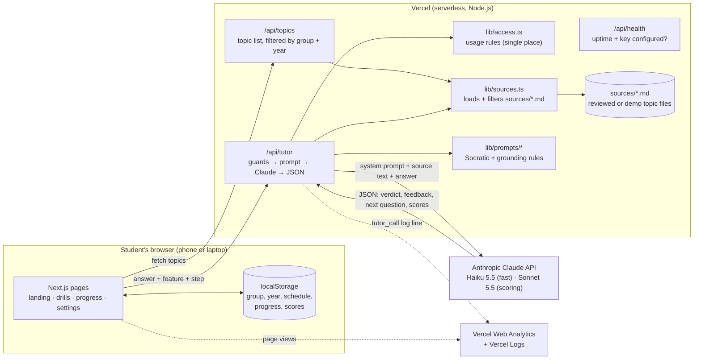

# Architecture Notes: Law AI Tutor - Taxation v1

**AI capability:** a Socratic **chat** tutor with **classification and scoring** (verdict per turn; the AI labels each ALAC part and code computes a 0–5 Practice score with a 5-point bar-coach rubric), grounded in retrieved source files.

## 1. System overview



| Layer | Technology | Responsibility |
|---|---|---|
| **UI** | Next.js 15 App Router, React 19, Tailwind CSS 4 | Screens; client-side answer validation; class-time check before any call; saves progress after every turn |
| **Backend** | Next.js route handlers on Vercel (Node.js runtime) | Re-checks usage rules on the server, validates input, builds prompts, calls Claude, parses JSON, never leaks errors |
| **AI layer** | Anthropic Claude via `@anthropic-ai/sdk` | `claude-haiku-5-5` for recitation and Quick Check (speed); `claude-sonnet-5-5` for labelling ALAC parts and coaching (judgment) |
| **Data / retrieval** | Markdown files in `sources/` with YAML front matter | One topic per file: article text, key points, fact pattern, bar problem, ALAC model answer, year tags, reviewer sign-off or `status: demo` |
| **State** | Browser `localStorage` only | No accounts, no database, no student data on the server (privacy by design) |
| **Monitoring** | Vercel Web Analytics; JSON logs; `/api/health` | Page views; per-call model, latency and outcome; uptime and key-configured check |
| **CI/CD** | GitHub Actions → Vercel Git integration | Lint, typecheck, 75 tests, production build, Gitleaks secret scan; Vercel auto-deploys `main` |

## 2. Data flow: one problem-drill turn

1. **Landing → drills page:** the landing page saves the chosen year or bar group on the device. On the drills page, `GET /api/topics?group=year-1-2&year=2` → `lib/sources.ts` reads `sources/*.md`, drops files that are neither reviewed nor demo, keeps topics tagged `year-2`, and returns titles only (never model answers).
2. **Client guards:** an empty answer means no call ("Type your answer first"); length is capped at 4,000 characters; a device rate limit of 30 per hour applies; class hours are checked in **Asia/Manila** time.
3. **`POST /api/tutor`** with `{feature, topicId, userGroup, studentAnswer, step, phase}`.
4. **Server guards, in order:** required fields → `canUseFeature()` from `lib/access.ts` (a Year 1–2 user in class gets 403 and **no AI call**) → topic must be visible to that group → empty or over-length answer → a graded-work request ("write my case digest") is declined without calling the AI.
5. **Prompt assembly:** shared Socratic rules + the feature prompt + **only this topic's** source text, key points and model answer → JSON schema instruction.
6. **Claude call** (Sonnet for scoring) → log `{model, ms, outcome}` → parse JSON → refusal or `max_tokens` → friendly "unavailable" message.
7. **Scoring (problem drill):** Claude returns only labels (each ALAC part correct / incorrect / missing; responsive or not). `lib/problemScoring.ts` and `lib/rubric.ts` compute the 0–5 Practice score, its reason, the 2/1/0 weak-spot values and the part to coach, in code. Any number in Claude's reply is ignored.
8. **Response:** score and reason, labelled ALAC parts with notes, strengths and gaps, next Socratic question. The model answer is withheld until after the retry (or shown at once on 5/5).
9. **Client** saves the turn to `localStorage` (resume) and adds scores to weak-spot tracking.

## 3. Key design decisions

| Decision | Why | Trade-off |
|---|---|---|
| **Files, not a vector database, for retrieval** | Each drill uses exactly one known topic, so "retrieval" is a file lookup. A lawyer can edit Markdown without a programmer. | Doesn't scale to thousands of topics; v2 can add search |
| **Usage rules in one file** (`lib/access.ts`), enforced on client **and** server | Faculty trust depends on these never weakening; one place makes them testable (14 tests) | The honor system: the user declares their own group |
| **Demo topics with a visible banner** | The live app needs content before lawyer sign-off; a banner keeps it honest | A demo topic must be removed or signed off before a real pilot |
| **Two models** | Haiku keeps Quick Check under about 5 s and cheap; Sonnet scores essays more reliably | Two prompts to maintain |
| **No accounts or database** | Privacy (no student data on the server), zero ops, faster to ship | Progress doesn't sync across devices |
| **AI labels, code scores** (5-point rubric in `lib/rubric.ts`) | The same labels always give the same score; every rubric row is unit-tested; the AI cannot inflate a number | Label quality still depends on the AI; the accuracy gate reviews labels |
| **Structured JSON output from Claude** | The UI needs scores and verdicts it can rely on | Needs defensive parsing (done in `parseJson`) |

## 4. Security and secrets
- `ANTHROPIC_API_KEY` is read only in `app/api/tutor/route.ts` via `process.env`. It is stored in `.env.local` (git-ignored) and in Vercel Environment Variables, and is never sent to the browser.
- `.env*.local` and `.env` are in `.gitignore`; `.env.example` holds only an empty placeholder.
- CI runs **Gitleaks** over the full Git history on every push.
- Input validation happens on the server, not just in the UI: allowed groups, year 1–4, answer length, topic visibility, and the class-time check.
- Errors are logged server-side (message only, no student text); users see only a friendly message.

## 5. Deployment pipeline
```
git push (main) ──► GitHub Actions: lint → typecheck → vitest (75) → next build ─┐
                 └► Gitleaks secret scan                                          ├─► green ✓
                 └► Vercel Git integration: build + deploy to law-tutor-drill.vercel.app
```
The Claude API is faked in tests, so CI needs no API key and costs nothing.

## 6. Folder map
```
app/               pages + API routes (api/tutor, api/topics, api/health)
components/        DemoBanner, FeatureCard, AnswerBox, ClassPauseBanner, GroupGuard
lib/access.ts      usage rules by group and Manila time
lib/subject.ts     this app's subject: areas in teaching order and the year plan
lib/profiles.ts    Year 1–4 / bar choices (from subject.ts) → usage group
lib/sources.ts     topic loader, demo handling, year filtering, subject order
lib/rubric.ts      5-point bar-coach rubric: ALAC labels → 0–5 Practice score
lib/problemScoring.ts  Claude's labels → scorecard, coaching focus, retry re-score
lib/prompts/       Socratic, grounding and JSON instructions per feature
lib/storage.ts     on-device state, weak spots, rate limit
lib/monitoring.ts  one JSON log line per Claude call
sources/           topic files (law content lives only here)
tests/             75 Vitest tests mapped to spec acceptance criteria
docs/              validation report, PRD, architecture, reflection, demo script
```
